# FinCore

**A ledger-backed payment processing platform.** Payments, refunds, payouts and settlement reconciliation on a double-entry ledger whose rules are enforced by PostgreSQL itself, so money can't be created, lost, double-charged or quietly edited, even under heavy concurrency or when the payment provider misbehaves.

It's three applications:

| App | What it is | Stack | Port |
|---|---|---|---|
| **API + worker** (`cmd/`, `internal/`) | The payments engine: REST API, ledger, Razorpay integration, background jobs | Go · PostgreSQL · Dragonfly | 8080 |
| **Admin dashboard** (`dashboard/`) | Operations console for the platform team, behind a sign-in | Next.js 16 | 3100 |
| **Landing page** (`site/`) | Marketing site | Next.js 16 | 3200 |

```
14,825 requests in 30 s · 0 duplicate charges · 0 unexpected errors · money conserved to the paisa
```
<sub>k6 load test: concurrent payments, triple-retried requests and payouts racing to drain one balance (`make load-test`).</sub>

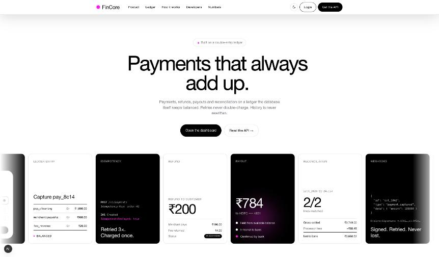

---

## Contents

1. [What problem it solves](#1-what-problem-it-solves)
2. [Tour of the applications](#2-tour-of-the-applications)
3. [How money moves](#3-how-money-moves-the-ledger)
4. [Architecture](#4-architecture)
5. [Test mode and live mode](#5-test-mode-and-live-mode)
6. [Authentication, team and roles](#6-authentication-team-and-roles)
7. [Run it locally](#7-run-it-locally)
8. [Using the API](#8-using-the-api)
9. [Tests and proof](#9-tests-and-proof)
10. [Observability](#10-observability)
11. [Design system](#11-design-system)
12. [Project layout](#12-project-layout)

---

## 1. What problem it solves

A payments platform sits between customers, merchants, a payment processor (Razorpay) and a bank. The hard part is not calling the processor. It's making sure **every rupee is accounted for** when things go wrong:

| What goes wrong in real life | What FinCore does |
|---|---|
| The customer double-clicks "Pay", or the network retries | `Idempotency-Key` replays the first response; unique keys in Postgres back it up. Charged once. |
| Two payouts race to drain the same balance | Row locks in a fixed order plus a database `CHECK` mean the balance never goes negative. |
| The browser closes before the payment is confirmed, *and* the webhook is lost | A background sweeper asks Razorpay directly and completes the payment. |
| Razorpay is down in the middle of a refund | The ledger is posted first and rolled back if Razorpay fails, so no half-done refunds. |
| Razorpay says it settled a payment we never recorded | Settlement reconciliation flags it as `missing_in_ledger`. |
| Someone "fixes" a wrong amount with an `UPDATE` | The database refuses. History is append-only; mistakes are fixed with reversals. |
| A merchant's webhook endpoint is down | Events wait in a transactional outbox and are retried with backoff, then dead-lettered for a human. |

## 2. Tour of the applications

### Landing page — `localhost:3200`

The public face of the product. It explains the ledger, the products and the engineering guarantees, using the platform's own numbers. Its **Login** button takes operators to the dashboard's sign-in page.

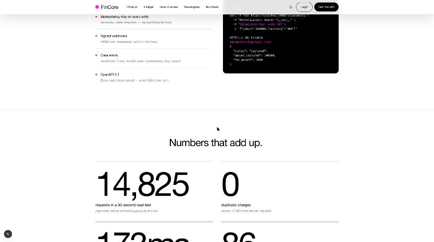

### Sign in — `localhost:3100/login`

The dashboard is operators-only. Any dashboard URL sends you here first; after signing in you land on the page you originally asked for.

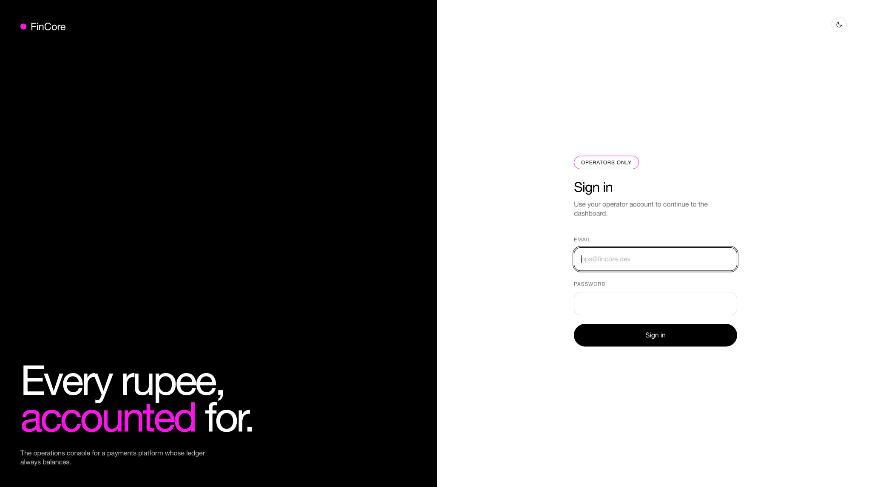

### Console layout

The dashboard is laid out like a production console:
- **Sidebar:** grouped navigation (Payments, Finance, Developers, Settings), with the **Test | Live** switch, theme toggle and signed-in user at the bottom.
- **Top bar:** breadcrumbs and a **global search** (`⌘K` / `Ctrl+K`). It finds payments by ID prefix, Razorpay order or payment ID, or description, and merchants by name or ID.
- **Mobile:** the sidebar becomes a slide-out drawer.

### Overview — analytics

A **7 / 30 / 90-day** range switch (IST calendar days) drives everything on the page:
- **KPI tiles:** captured volume, successful payments, success rate, average ticket and platform fees. Each shows the change against the previous period and a sparkline.
- **Captured volume per day:** an area trend with a hover crosshair.
- **Payments by status:** ranked bars that link to the filtered payments list.
- **Successful vs failed per day:** stacked columns. Failures are the one accent colour; successes are context grey.
- **Top merchants by volume.**
- **System health:** ledger integrity, webhook delivery, provider webhooks and reconciliation. Anything unhealthy turns pink.

Every chart has a hover tooltip and an expandable **data table**, follows the chart rules in `DESIGN.md`, and works in light and dark mode. The colour pairing was validated for colour-blind separation.

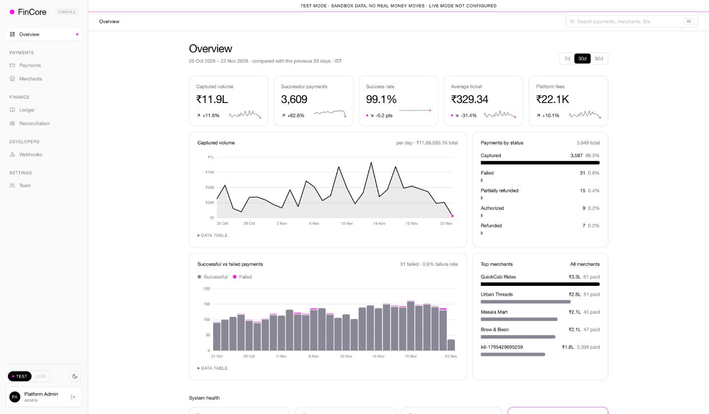

### Payments → payment detail

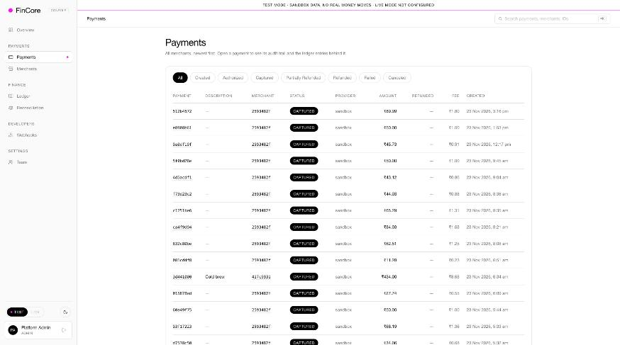

Payments are filterable by status and paginated newest-first. A payment's page shows:
- **Audit trail:** every state change, with amounts and reasons.
- **Refunds.**
- **Ledger entries:** the exact balanced debit/credit lines the payment and its refunds created.

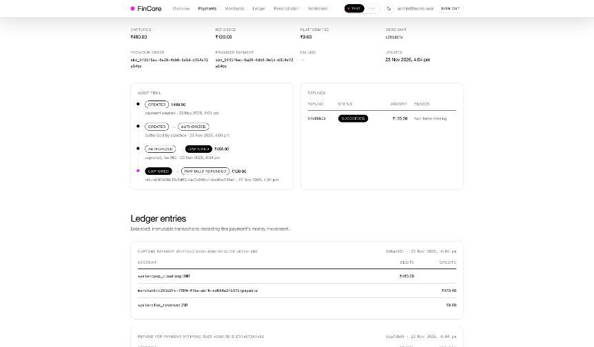

### Merchants → merchant detail

- **Create merchants**, which issues a one-time API key.
- **Balances.**
- **Statement:** 30 days, with a running balance.
- **Paginated payouts:** in test mode you can simulate the bank paying or rejecting a payout.
- **API keys.**

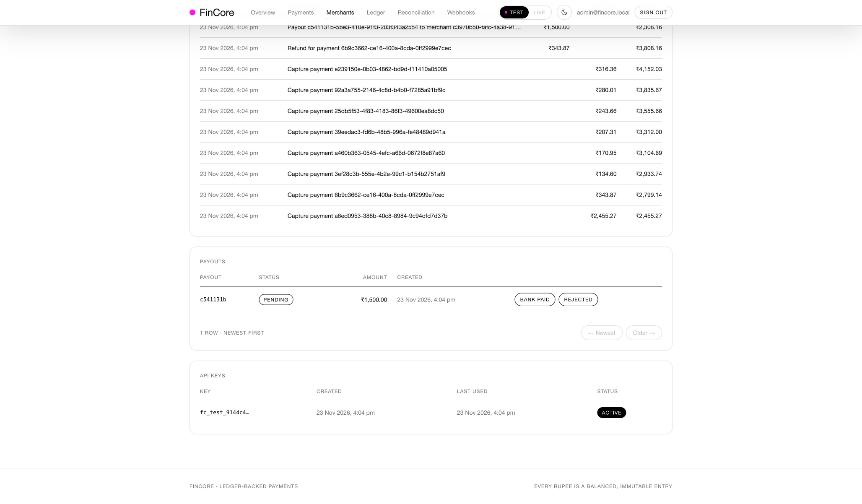

### Ledger

All accounts with debits, credits and balances, and the integrity check result.

### Reconciliation

Upload the processor's settlement CSV:
- **Matched lines** move money from clearing to the bank, net of processor fees.
- **Mismatches** are listed as exceptions: missing in ledger, amount mismatch, status mismatch, duplicate, unsupported.
- **Unsettled:** payments captured more than 3 days ago that the processor still hasn't settled.

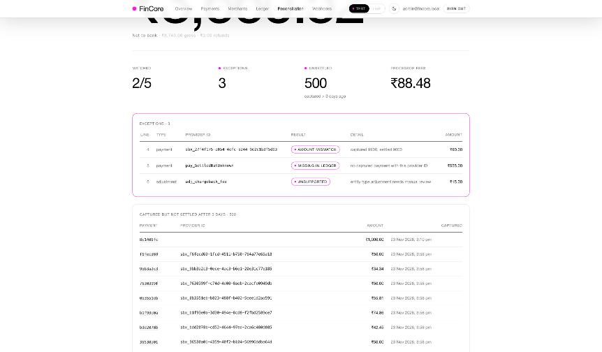

### Webhooks

Every event in the transactional outbox, with its delivery status, attempt count and last error. Dead-lettered events can be retried with one click.

### Team — invite-only access with roles

Admins invite teammates by email as **Admin** or **Read-only**. The invite produces a one-time link (valid 72 hours) to copy and send privately. The page also lists:
- members, with their roles and last sign-in
- pending invites
- an **activity log** of every invite, sign-in, failed sign-in and role change

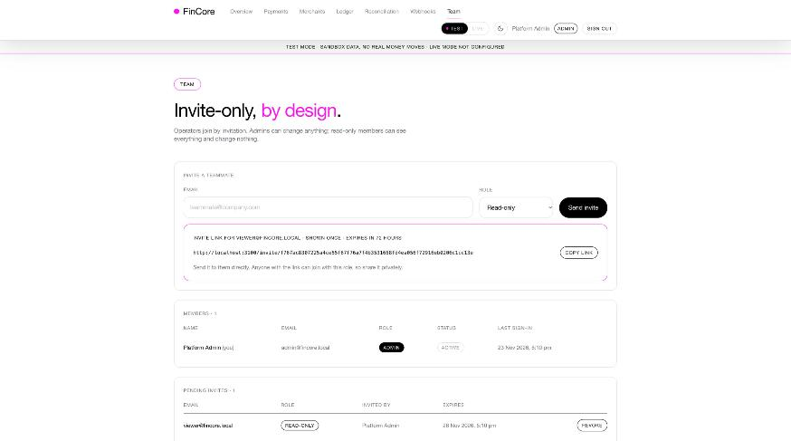

The invited person opens the link, sets their name and password, and is signed straight in. Used, revoked and expired links stop working.

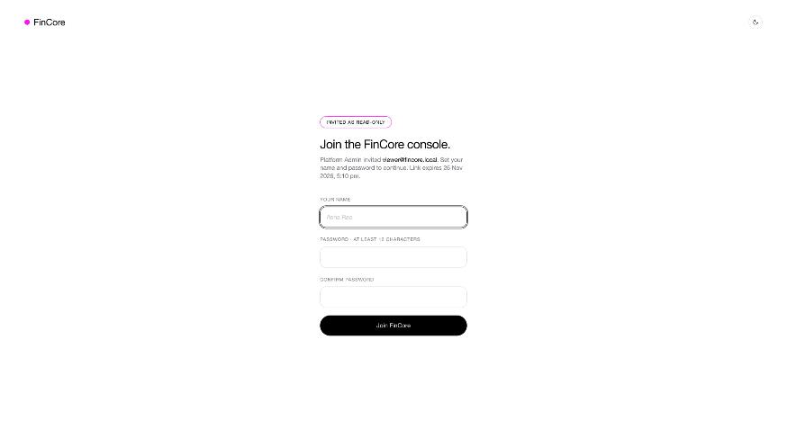

### Dark mode

Both apps follow the OS theme and have a toggle. The choice is remembered, with no flash on load.

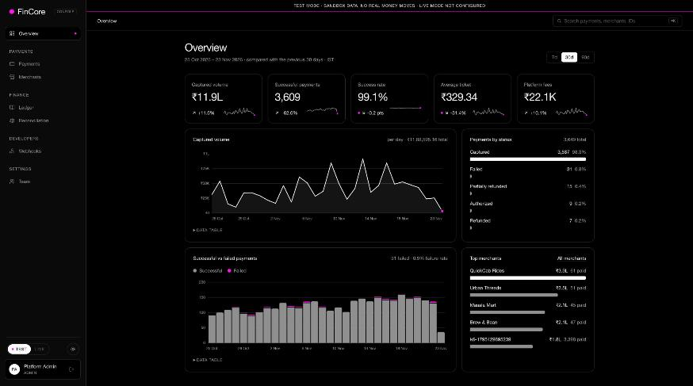

## 3. How money moves (the ledger)

Every operation is a **double-entry transaction**: two or more postings whose debits equal credits. Balances are never stored as numbers to overwrite; they're derived from the postings.

| Operation | Debit | Credit |
|---|---|---|
| Capture ₹1,000 (2% fee) | psp_clearing 1,000 | merchant payable 980 · fee_revenue 20 |
| Refund ₹200 (fee returned pro rata) | merchant payable 196 · fee_revenue 4 | psp_clearing 200 |
| Payout ₹784 created → bank confirms | merchant payable → payouts_in_transit | payouts_in_transit → psp_clearing |
| Settlement matched | bank (net) · processor_fees | psp_clearing |

What the **database** guarantees (not just the Go code):
- **Balanced transactions:** a transaction whose debits don't equal its credits is refused at `COMMIT`, by a deferred constraint trigger.
- **Append-only history:** `UPDATE` and `DELETE` on ledger tables raise errors.
- **Currency consistency:** a posting's currency must match its account's.
- **No overdrafts:** accounts that must not go negative have a `CHECK` constraint.
- **Valid state changes only:** payment state transitions are checked against a `status_transitions` table.

Payment lifecycle: `created → authorized → captured → partially_refunded → refunded`, plus `failed` and `canceled`.

Design decisions are written up in [`docs/adr/`](docs/adr).

## 4. Architecture

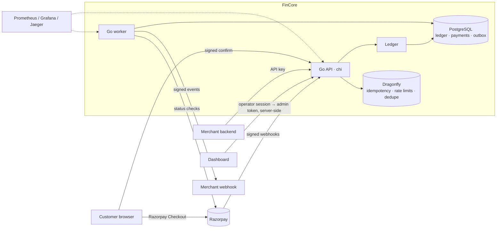

### A Razorpay payment, end to end

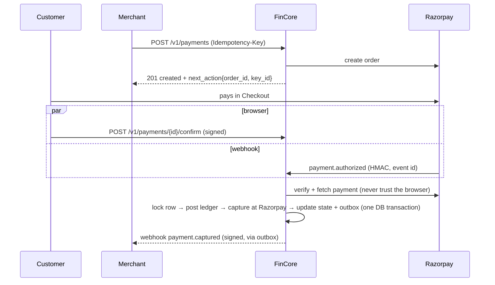

**Background worker jobs:**
- **Outbox delivery:** sends signed events to merchant endpoints, with retries and dead letters.
- **Webhook retries:** re-applies provider webhooks that failed.
- **Sweeper:** recovers payments whose callbacks were lost and expires unpaid ones.
- **Integrity check:** re-verifies the whole ledger every 5 minutes.

## 5. Test mode and live mode

As in Razorpay, **test and live are completely separate**:

| | Test mode | Live mode |
|---|---|---|
| Start with | `FINCORE_MODE=test` (default) | `FINCORE_MODE=live` |
| Database | its own | **a different one** |
| API keys | `fc_test_…` | `fc_live_…` |
| Razorpay keys | `rzp_test_…` only | `rzp_live_…` only |
| Sandbox provider, test cards, simulated bank | ✅ | ❌ disabled |
| Real money | never | yes |

**Guardrails:**
- **Database stamp:** on first start, the database records its mode. The API **refuses to start** against a database stamped with the other mode.
- **Key prefixes:** a test key sent to the live API (or the reverse) is rejected with `wrong_mode`.
- **Live config:** live mode refuses to start with test Razorpay keys, or without a webhook secret and admin token.
- **Mode header:** every response carries a `FinCore-Mode` header.

**In the dashboard**, the **Test | Live** switch picks which API you're looking at. Live stays disabled until you configure it:

```bash
# dashboard/.env.local
FINCORE_LIVE_API_URL=https://api.live.example.com
FINCORE_LIVE_ADMIN_TOKEN=...
```

## 6. Authentication, team and roles

| Who | How | Where |
|---|---|---|
| **Operators → dashboard** | Invite-only accounts (email + bcrypt password) → signed, HTTP-only session cookie (8 h). Checked in `proxy.ts`, then re-validated against the database on every request. | `localhost:3100` |
| **Merchants → API** | `Authorization: Bearer fc_test_…` API key. Only a SHA-256 hash is stored; keys can be revoked; each merchant sees only their own data. | `/v1/*` |
| **Dashboard → API** | Admin token, server-side only; it never reaches the browser. The acting operator's ID is sent with each request and recorded in the audit log. | `/v1/admin/*` |
| **Razorpay → API** | HMAC-SHA256 webhook signatures, deduplicated by event ID. | `/webhooks/razorpay` |
| **Customer's browser → API** | Razorpay's signed checkout result, verified and then re-fetched from Razorpay. | `/v1/payments/{id}/confirm` |

### Roles

| | Admin | Read-only |
|---|---|---|
| See every page: payments, ledger, reconciliation, webhooks, team | ✅ | ✅ |
| Switch test / live view | ✅ | ✅ |
| Create merchants, import settlements, retry webhooks, simulate payouts | ✅ | ❌ |
| Invite people, change roles, disable accounts, revoke invites | ✅ | ❌ |

Roles are enforced **on the server** (every mutating server action checks it); hiding buttons is only a convenience.

### How the invite flow works

1. **Invite:** an admin enters an email and a role on **Team**. The API stores only a SHA-256 hash of a 256-bit random token, valid 72 hours, and the dashboard shows the link once.
2. **Re-invite:** inviting the same email again revokes the earlier link.
3. **Accept:** the invitee opens `/invite/<token>` (no sign-in needed), sets a name and a password of at least 12 characters, and is signed in. The token works **once**.
4. **Sign-in:** passwords are checked with bcrypt. Unknown emails take as long as wrong passwords, so you can't probe which accounts exist. Failed attempts are logged.

### Guarantees
- **Immediate effect:** disabling someone or changing their role takes effect on their very next request, because sessions carry a version that the change invalidates.
- **No lockout:** the last active admin can never be demoted or disabled, and that holds even if two admins demote each other at the same moment. Nobody can change their own access.
- **Audit trail:** every action lands in the append-only `operator_events` log.

### The first admin

There's no public sign-up. Create the first admin from the server:

```bash
make invite-admin EMAIL=you@company.com          # prints a one-time /invite/... link
```

Open the link, set a password, then invite everyone else from **Team**. For local development, `admin@fincore.local` (admin) and `viewer@fincore.local` (read-only) already exist. Their passwords are in the git-ignored `dashboard/.dev-credentials`.

Dashboard settings (`dashboard/.env.local`):

```bash
SESSION_SECRET=$(openssl rand -hex 32)   # signs session cookies
DASHBOARD_URL=http://localhost:3100      # used to build invite links
# FINCORE_AUTH_API_URL / FINCORE_AUTH_ADMIN_TOKEN — where operator accounts live
# (defaults to the test-mode API; point at a dedicated deployment or SSO in production)
```

## 7. Run it locally

Requires Go 1.26, Docker, Node 22+ and pnpm.

```bash
cp .env.example .env              # set ADMIN_API_TOKEN: openssl rand -hex 24
make up                            # Postgres :5434 + Dragonfly :6379
make migrate
make api                           # API :8080   (metrics :9091)
make worker                        # worker      (metrics :9092)
./scripts/seed.sh                  # demo merchants, payments, refunds, payouts, reconciliation
python3 scripts/seed_history.py    # 90 days of demo history for the charts (test mode only)

make invite-admin EMAIL=you@company.com      # first admin: open the printed link

cd dashboard && cp .env.example .env.local   # fill in tokens + SESSION_SECRET
pnpm install && pnpm dev -p 3100             # http://localhost:3100

cd ../site && pnpm install && pnpm dev -p 3200   # http://localhost:3200
```

Everything in containers, plus Prometheus (:9090), Grafana (:3001) and Jaeger (:16686):

```bash
docker compose --profile app --profile observability up -d --build
```

> **Port already in use?** `lsof -ti :3200 | xargs kill`

## 8. Using the API

```bash
# Admin creates a merchant; the response includes its API key (shown once)
curl -s -X POST localhost:8080/v1/admin/merchants \
  -H "Authorization: Bearer $ADMIN_API_TOKEN" -H "Idempotency-Key: $(uuidgen)" \
  -d '{"name":"Chai Point","currency":"INR","fee_bps":200}'

# Merchant takes ₹1,000 (sandbox test card). Retry with the same key → same response, charged once.
curl -s -X POST localhost:8080/v1/payments \
  -H "Authorization: Bearer fc_test_..." -H "Idempotency-Key: order-42" \
  -d '{"amount":100000,"currency":"INR","payment_method":"pm_card_success"}'

# Page through payments, newest first
curl -s "localhost:8080/v1/payments?limit=50" -H "Authorization: Bearer fc_test_..."
# → {"data":[...], "next_cursor":"...", "has_more":true}   then  ?cursor=<next_cursor>
```

- **Amounts** are integers in paise.
- **Errors** look like `{"error":{"code":"insufficient_funds","message":"..."}}`.
- **Full reference:** [`internal/httpapi/openapi.yaml`](internal/httpapi/openapi.yaml), also served at `/openapi.yaml`. A test fails if any route is undocumented.
- **Real Razorpay (test mode):** set `RAZORPAY_*` in `.env`, create a payment with `"provider":"razorpay"`, open `localhost:8080/dev/checkout/<payment_id>` and pay with card `4111 1111 1111 1111`.

## 9. Tests and proof

```bash
make test         # all Go tests, race detector on, real Postgres + Dragonfly via testcontainers
make test-stress  # ledger invariants across 1,000 random scenarios (property-based)
make load-test    # k6 against a running API
```

What the tests prove:
- **The database itself refuses bad data:** raw SQL that breaks an invariant is rejected (unbalanced, edited, overdrawn, illegal state change, wrong mode).
- **Concurrency:**
  - 100 concurrent ₹1 spends on a ₹50 wallet: exactly 50 succeed.
  - 20 concurrent captures: exactly 1 succeeds.
  - 25 identical requests: charged once.
  - Opposing transfers never deadlock.
- **Razorpay flows** against an in-memory fake:
  - confirm and webhook racing in either order, and duplicate deliveries
  - a failed attempt followed by a successful one
  - outages mid-capture and mid-refund (the ledger rolls back)
  - pending refunds that later fail (the ledger entry is reversed)
- **Outbox:** signed delivery, retries, dead letters, and concurrent workers delivering each event exactly once.
- **Reconciliation:** matched, missing, mismatched and duplicate lines, and re-imported files.
- **Auth and modes:** missing, revoked and wrong-mode keys; cross-merchant isolation; per-merchant idempotency scope; refusing to start in the wrong mode.
- **Team:**
  - invite → accept → sign in
  - single-use, expired, revoked and re-issued links
  - password policy, and identical errors for unknown emails and wrong passwords
  - disabled accounts can't sign in
  - the last-admin guard, including two admins demoting each other concurrently
  - the audit log
- **Pagination:** every row is returned exactly once across pages.

CI (`.github/workflows/ci.yml`) runs gofmt, vet, an sqlc drift check, all tests, the 1,000-scenario stress test, govulncheck and the Docker build, plus typecheck, lint and build for both frontends.

## 10. Observability

- **Metrics** (`/metrics` on internal ports 9091/9092):
  - request rate and latency per route
  - payment transitions and idempotent replays
  - rate limiting and webhook results
  - outbox backlog and dead letters
  - sweeper actions and ledger integrity
- **Alerts** ([`deploy/prometheus/alerts.yml`](deploy/prometheus/alerts.yml)):
  - **page:** the ledger integrity check fails, or the 5xx rate exceeds 2%
  - **warn:** outbox backlog, dead letters, or an integrity check that has gone stale
- **Tracing:** OpenTelemetry for HTTP and every SQL query. Set `OTEL_EXPORTER_OTLP_ENDPOINT=http://localhost:4318`.
- **Grafana dashboard:** provisioned automatically.

## 11. Design system

Both frontends share one design system, documented in [`dashboard/DESIGN.md`](dashboard/DESIGN.md):
- **Palette:** a white gallery with black structure and a single neon-pink accent.
- **Type:** Helvetica Neue at weight 400 only; hierarchy comes from size and letter-spacing.
- **Shape:** flat surfaces with pill buttons.
- **Modes:** full light and dark.
- **Motion and accessibility rules.**

## 12. Project layout

```
cmd/            api · worker · migrate · operator (invite CLI) · demo
internal/
  ledger/       double-entry core: post, reverse, balances, statements, integrity
  payments/     payments, refunds, payouts, provider events, sweeper, reconciliation, API keys, pagination
  provider/     Provider interface · sandbox · razorpay (+ razorpaytest fake)
  outbox/       signed webhook delivery with retries and dead letters
  httpapi/      REST API, auth, webhooks, OpenAPI spec
  idempotency/  Dragonfly-backed Idempotency-Key middleware
  ratelimit/    Dragonfly fixed-window limiter
  operators/    dashboard accounts: invites, roles, sign-in, audit log
  platform/     config, test/live mode guard, clients, tracing
  metrics/ store/ (sqlc-generated) testutil/
db/             goose migrations + sqlc queries
dashboard/      Next.js 16 admin console (sign-in, team & roles, test/live switch, design system: DESIGN.md)
site/           Next.js 16 landing page
deploy/         Prometheus, alerts, Grafana
docs/           ADRs, screenshots
scripts/        k6 load test, demo seed
```

**Stack:** Go 1.26 · chi · PostgreSQL 17 · pgx · sqlc · goose · Dragonfly · go-redis · Razorpay · Prometheus · OpenTelemetry · testcontainers · rapid · k6 · Next.js 16 · Tailwind 4 · Docker · GitHub Actions
